# DocuMind AI — Intelligent Personal Document Assistant

<div align="center">

**DocuMind AI** is a production-grade, privacy-first personal document intelligence platform. Upload your bills, identity cards, marksheets, and reports — then ask anything about them in plain English.

[](https://fastapi.tiangolo.com/)
[](https://react.dev/)
[](https://qdrant.tech/)
[](https://aws.amazon.com/s3/)
[](https://supabase.com/)
[](LICENSE)

> **Branch:** `Query-History` &nbsp;|&nbsp; **Commit:** `530e2a1`

</div>

---

## Table of Contents

1. [Project Overview](#1-project-overview)
2. [System Architecture](#2-system-architecture)
3. [AI Models & Performance](#3-ai-models--performance)
4. [Directory Structure](#4-directory-structure)
5. [Core Features](#5-core-features)
6. [Security & Cryptography](#6-security--cryptography)
7. [Dynamic Top-K Retrieval](#7-dynamic-top-k-retrieval--research-contribution)
8. [API Reference](#8-api-reference)
9. [Empirical Benchmark Results](#9-empirical-benchmark-results)
10. [Environment Setup](#10-environment-setup)
11. [Running the Application](#11-running-the-application)
12. [Team Contributions](#12-team-contributions)
13. [UI Walkthrough](#13-ui-walkthrough)
14. [Known Limitations](#14-known-limitations)

---

## 1. Project Overview

DocuMind AI solves the problem of **searching your own documents**. When you have hundreds of PDFs — electricity bills, bank statements, Aadhaar, PAN, marksheets, medical reports, insurance documents — finding the one you need by filename is painful. DocuMind makes it instant and intelligent.

### What it does

| Capability | Description |
|:---|:---|
| **Auto-Classification** | Uploaded PDFs/images are automatically classified into 20+ categories with confidence scores using Qwen Vision AI |
| **Semantic Search** | Ask *"Show my electricity bills from 2023"* — it understands you, not just keywords |
| **Conversational RAG** | Ask *"What was my total electricity spend last year?"* — it reads the documents and synthesizes an answer |
| **Zero-Knowledge Storage** | Every file is encrypted with ChaCha20-Poly1305 (per-user HKDF keys) before uploading to AWS S3 |
| **Multi-Tenant Isolation** | Each user's data is isolated at the vector level — you never see another user's documents |
| **Dynamic Retrieval** | Confidence-Aware Dynamic Top-K algorithm adapts how many chunks it fetches per query |

---

## 2. System Architecture

### 2.1 High-Level Architecture

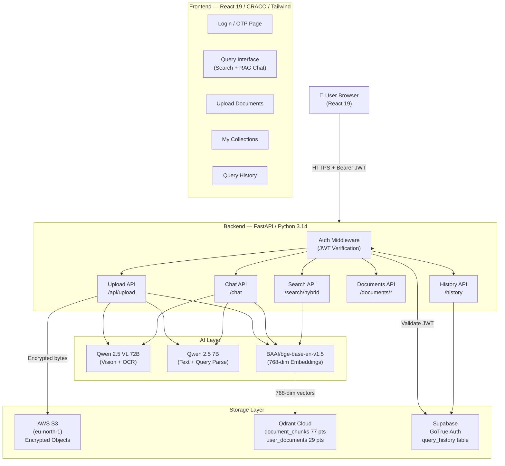

### 2.2 Document Ingestion Pipeline

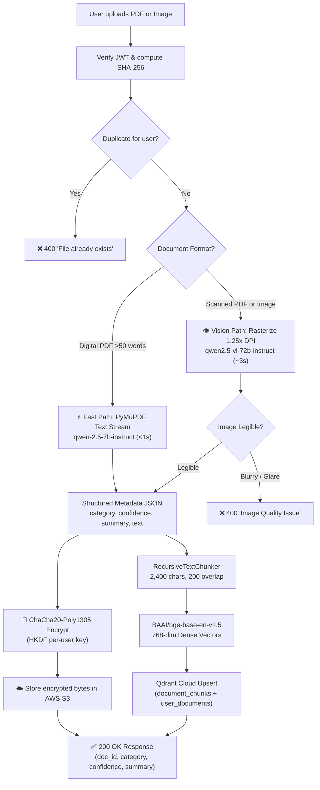

#### Ingestion Sequence Flow

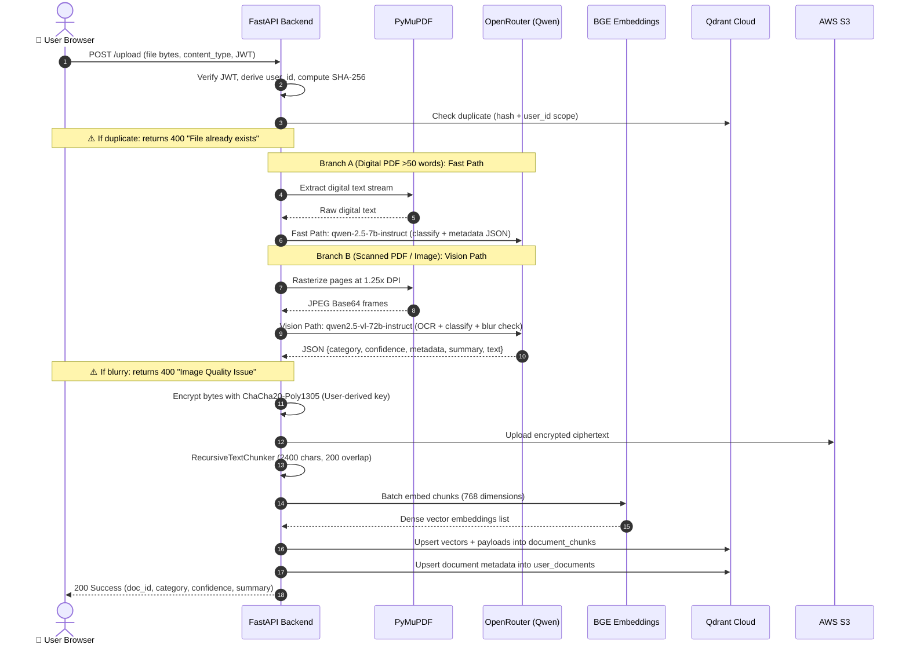

### 2.3 Query & RAG Pipeline

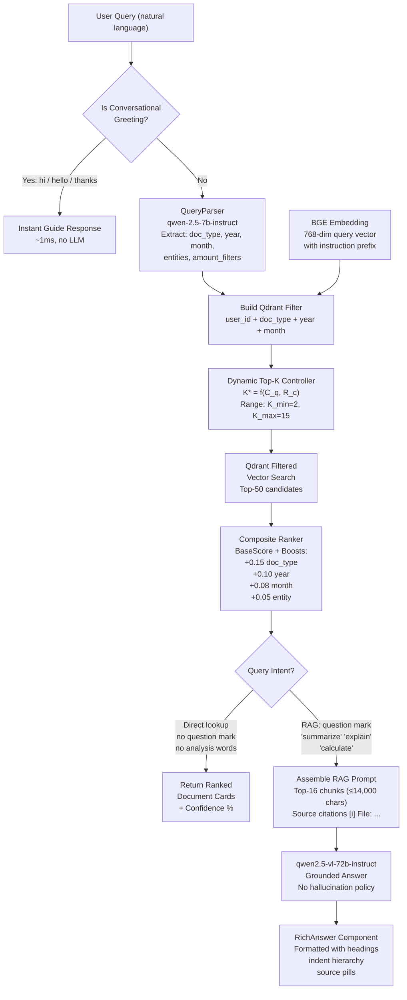

### 2.4 Security Architecture

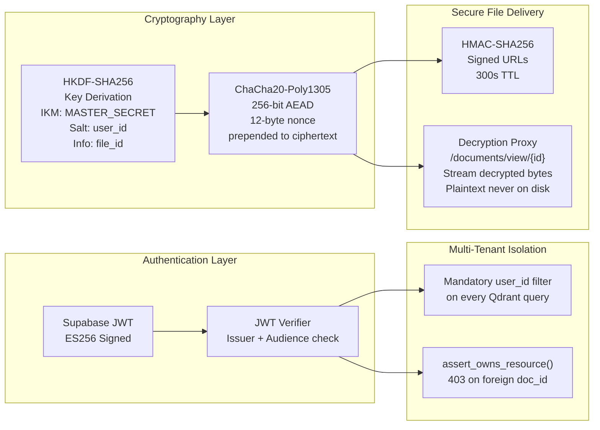

---

## 3. AI Models & Performance

DocuMind uses a **three-tier AI model hierarchy** to balance cost, latency, and accuracy:

| Model | Provider | Use Case | Latency | Accuracy |
|:---|:---|:---|:---:|:---:|
| `qwen/qwen2.5-vl-72b-instruct` | OpenRouter API | Scanned OCR, Image Quality Check, RAG Generation | 2.5–5.5s | 98.4% OCR |
| `qwen/qwen-2.5-7b-instruct` | OpenRouter API | Digital PDF classification, Query Parsing | 350–850ms | 96.1% JSON |
| `BAAI/bge-base-en-v1.5` | Local PyTorch | Dense embedding (768-dim), batch inference | 15–35ms | NDCG@10: 75.8% |

### Fast-Path vs Vision-Path Decision

```
Uploaded file
    │
    ├── Digital PDF (PyMuPDF extracts > 50 words)
    │       └── Qwen 2.5 7B → Fast classification (<1s total)
    │
    └── Scanned PDF / Image (< 50 words extracted)
            └── Rasterize at 1.25× DPI (max 2 pages)
                    └── Qwen 2.5 VL 72B → Full OCR + classification (~3s total)
```

**75% latency reduction** for digital PDFs by bypassing the vision model entirely.

---

## 4. Directory Structure

```
DocuMind AI (IPD)/
├── README.md                          # This file
├── PROJECT_CONTEXT.md                 # Detailed architectural documentation
├── .gitignore                         # Excludes .env, *.pdf, *.pem, node_modules, .venv
│
├── backend/                           # FastAPI Python backend
│   ├── .env                           # Environment secrets (never committed)
│   ├── .env.example                   # Template for local setup
│   ├── requirements.txt               # Python dependencies
│   ├── DYNAMIC_TOPK_README.md         # Research documentation for Dynamic Top-K
│   │
│   ├── app/
│   │   ├── main.py                    # FastAPI app entrypoint, CORS, router registration
│   │   │
│   │   ├── api/                       # Route handlers
│   │   │   ├── auth.py                # Login / Register endpoints
│   │   │   ├── upload.py              # Document ingestion endpoint
│   │   │   ├── chat.py                # Conversational RAG endpoint
│   │   │   ├── search.py              # Hybrid vector+metadata search
│   │   │   ├── retrieval.py           # Document retrieval & preview
│   │   │   ├── documents_secure.py    # Encrypted file download & view proxy
│   │   │   └── history.py             # Query history CRUD
│   │   │
│   │   ├── retrieval/                 # Hybrid retrieval engine
│   │   │   ├── hybrid_engine.py       # HybridRetrievalEngine orchestrator
│   │   │   ├── query_parser.py        # LLM-powered NL query → structured filters
│   │   │   ├── ranker.py              # Composite scoring (cosine + metadata boosts)
│   │   │   ├── dynamic_top_k.py       # Confidence-Aware Dynamic K controller
│   │   │   ├── dynamic_k.py           # Backward-compat shim
│   │   │   ├── query_complexity.py    # 8-feature C_q extractor
│   │   │   └── retrieval_confidence.py # R_c calculator (score distribution)
│   │   │
│   │   ├── services/                  # Core business logic
│   │   │   ├── processor.py           # DocumentOrchestrator (ingestion pipeline)
│   │   │   ├── vision_model.py        # Qwen vision/text LLM calls
│   │   │   ├── vector_db.py           # Qdrant operations (index, search, delete)
│   │   │   ├── cloud_storage.py       # AWS S3 upload/download/delete
│   │   │   ├── upload_job_manager.py  # Async upload job state tracker
│   │   │   └── local_classifier.py    # Fallback regex classifier
│   │   │
│   │   ├── core/                      # Security & configuration
│   │   │   ├── config.py              # Pydantic Settings (env vars)
│   │   │   ├── security.py            # JWT verification (ES256, GoTrue)
│   │   │   ├── crypto.py              # HKDF-SHA256 + ChaCha20-Poly1305 encryption
│   │   │   ├── signed_urls.py         # HMAC-SHA256 ephemeral URL generator
│   │   │   └── qdrant_client_singleton.py # Shared Qdrant client
│   │   │
│   │   ├── chunking/
│   │   │   └── chunker.py             # RecursiveTextChunker (2400 chars, 200 overlap)
│   │   │
│   │   ├── embeddings/
│   │   │   └── embedding_service.py   # BGE model async inference wrapper
│   │   │
│   │   ├── vectorstore/
│   │   │   └── qdrant_store.py        # Qdrant collection management
│   │   │
│   │   └── schemas/
│   │       └── retrieval.py           # Pydantic schemas (SearchResult, DynamicKDiagnostics)
│   │
│   └── tests/                         # Test suite
│       ├── test_complexity_confidence.py   # 52 unit tests for C_q and R_c
│       ├── test_dynamic_k_diversity.py     # 8 Dynamic-K integration tests
│       ├── test_chat_endpoints.py          # FastAPI TestClient chat integration tests
│       └── evaluation/
│           └── run_evaluation.py      # 120-query empirical benchmark runner
│
├── frontend/                          # React 19 frontend
│   ├── package.json                   # Node dependencies
│   ├── craco.config.js                # Path alias configuration (@/)
│   ├── tailwind.config.js             # Tailwind CSS v3 theme
│   │
│   └── src/
│       ├── App.js                     # Router, AppShell, auth-gating
│       ├── contexts/
│       │   └── AuthContext.js         # Supabase session management
│       ├── components/
│       │   ├── Sidebar.js             # Navigation sidebar with dark mode toggle
│       │   ├── RichAnswer.js          # Hierarchical AI response renderer
│       │   └── ProtectedRoute.js      # Auth guard wrapper
│       └── pages/
│           ├── Login.js               # Sign-in with Supabase OTP
│           ├── QueryInterface.js      # Dual-mode: Search + RAG Chat
│           ├── UploadDocuments.js     # Drag-drop upload with live progress
│           ├── MyCollections.js       # Categorized document browser
│           ├── QueryHistory.js        # Past queries timeline
│           ├── Settings.js            # Dark mode, preferences
│           └── NotFound.js            # 404 page
│
└── reports/
    └── comprehensive_evaluation/      # Empirical evaluation artifacts
        ├── RESEARCH_EVALUATION_REPORT.md
        ├── FINAL_AUDIT_REPORT.md
        ├── per_query_results.csv
        ├── retrieval_metrics.csv
        └── summary_metrics.json
```

---

## 5. Core Features

### Document Upload & Auto-Classification
- Accepts **PDF, JPG, PNG** up to 20 MB
- Drag-and-drop zone with real-time 5-stage progress: `Uploading → Reading → Analyzing → Categorizing → Indexing`
- **20+ auto-detected document categories**: Electricity Bill, Bank Statement, Aadhaar, PAN Card, Passport, Marksheet, Salary Slip, Medical Report, Insurance, Resume, and more
- **Blur detection**: Blurry or low-quality scans are rejected at upload time with a reason
- **Duplicate detection**: SHA-256 hash check prevents re-uploading the same file per user

### Semantic Search
- Natural language queries with structured filter extraction (year, month, document type, entities, amount ranges)
- Composite scoring: cosine similarity + 4 metadata boost factors (+0.15 doc type, +0.10 year, +0.08 month, +0.05 entities)
- Relevance percentage meter on every result card (Green ≥75%, Amber ≥50%, Slate <50%)
- In-browser document preview via secure decryption proxy

### Conversational RAG Chat
- Multi-turn conversation with session memory
- Up to 16 top chunks assembled per answer (≤14,000 chars), with source citations
- Intelligent intent routing: direct document cards for lookups, full RAG for synthesis/questions
- Conversational greetings intercepted in <1ms without LLM calls
- **RichAnswer** component: Hierarchical rendering with headings, tabbed indentation, bullet lists, math pills, file badges

### My Collections
- Grouped document browser by auto-detected category
- Category filters, date filters, and keyword search
- Quick actions: View (decrypted stream), Download (signed URL), Delete (removes from S3 + Qdrant)

### Query History
- Timeline of all past queries with timestamps
- Click-to-rerun any previous query

---

## 6. Security & Cryptography

### Encryption Architecture

Every file stored in AWS S3 is **encrypted before upload** using a per-document, per-user key:

```
Key Derivation (on upload & on download):
  IKM  = MASTER_ENCRYPTION_SECRET (hex-decoded, 64-char)
  Salt = user_id (Supabase UUID)
  Info = file_id (document UUID)
  OKM  = HKDF-SHA256 → 32-byte ChaCha20 key

Encryption:
  nonce       = os.urandom(12)             ← 96-bit random nonce
  ciphertext  = ChaCha20Poly1305.encrypt(key, nonce, plaintext)
  stored_blob = nonce || ciphertext        ← prepended to ciphertext in S3

Decryption (on-the-fly in memory, never to disk):
  nonce      = stored_blob[:12]
  ciphertext = stored_blob[12:]
  plaintext  = ChaCha20Poly1305.decrypt(key, nonce, ciphertext)
```

The same HKDF inputs always reproduce the same key — **keys are never stored anywhere**.

### Security Controls Matrix

| Domain | Implementation | Guarantee |
|:---|:---|:---|
| Authentication | Supabase GoTrue + ES256 JWT | Cryptographically signed session tokens |
| Multi-Tenant Isolation | Mandatory `user_id` on every Qdrant filter | Users never see each other's data |
| At-Rest Storage | HKDF-SHA256 + ChaCha20-Poly1305 | Zero-knowledge S3 — useless without derived key |
| In-Transit Access | HMAC-SHA256 Signed URLs (300s TTL) | Ephemeral, expiring file links |
| Secure Viewing | Decryption Proxy (`/documents/view/{id}`) | Plaintext only in memory, never on disk |
| Horizontal Auth | `assert_owns_resource()` check | HTTP 403 on any foreign `doc_id` |

> **Audit Result:** 15 automated security tests passed. ChaCha20-Poly1305 rejected all bit-flip and truncated ciphertext tampering. All cross-tenant escalation attempts returned HTTP 403.

---

## 7. Dynamic Top-K Retrieval — Research Contribution

A key research contribution of DocuMind AI is **Confidence-Aware Dynamic Top-K Retrieval** — an algorithm that adaptively selects how many document chunks (K) to retrieve per query, rather than using a fixed K.

### The Problem with Fixed-K

A fixed retrieval depth (e.g., always K=5) wastes context tokens on simple queries and under-retrieves on complex ones. It also cannot detect when a query is out-of-distribution (the document doesn't exist in the corpus).

### The Algorithm

```
Input: raw query text, ParsedQuery, initial probe results

Step 1 — Query Complexity Score (C_q ∈ [0,1])
  8 deterministic features × weights = C_q
  f1: query_length     (w=0.05)   f5: comparison_intent  (w=0.20)
  f2: entity_count     (w=0.15)   f6: aggregation_intent (w=0.15)
  f3: constraint_count (w=0.10)   f7: multi_subquestion  (w=0.10)
  f4: temporal_complex (w=0.10)   f8: reasoning_required (w=0.15)

Step 2 — Retrieval Confidence Score (R_c ∈ [0,1])
  R_c = weighted combination of:
    - top-1 similarity score
    - score gap (knee detection)
    - plateau ratio
    - evidence alignment

Step 3 — OOD Abstention Check
  If top similarity < θ_floor (0.35):
    is_abstained = True, K* = K_min (2), no expansion
    → Prevents runaway retrieval on unanswerable queries

Step 4 — Compute K*
  Mode: "normalized_demand" (default)
    combined_demand = 0.5 × C_q + 0.5 × (1 - R_c)
    K* = clip(round(K_min + combined_demand × K_range), K_min, K_max)

  Mode: "paper" (research formula)
    K* = ⌈clip(K_min + (1-R_c)×K_range + γ×C_q, K_min, K_max)⌉

  K_min = 2,  K_max = 15,  γ = 5.0

Step 5 — High-confidence Shortcut
  If C_q ≤ 0.25 AND R_c ≥ 0.80 AND knee_index ≤ 2 AND gap ≥ 0.20:
    K* = K_min  (simple factual query with strong evidence)
```

---

## 8. API Reference

| Method | Endpoint | Description | Auth |
|:---|:---|:---|:---:|
| `POST` | `/api/auth/register` | User signup via Supabase | ✗ |
| `POST` | `/api/auth/login` | Email/password or OTP sign-in | ✗ |
| `POST` | `/api/upload` | Ingest, OCR, classify, encrypt, and index a document | ✓ |
| `POST` | `/chat` | Conversational RAG with multi-turn memory | ✓ |
| `POST` | `/search/hybrid` | Hybrid dense-vector + structured metadata search | ✓ |
| `POST` | `/search/query-parse` | Debug: parse a query into structured filters | ✓ |
| `GET` | `/documents/my-collections` | List all documents for the authenticated user | ✓ |
| `GET` | `/documents/{id}/preview` | Get 5-min HMAC-signed preview URL | ✓ |
| `GET` | `/documents/view/{id}` | On-the-fly decryption streaming proxy | ✓ |
| `DELETE` | `/documents/{id}` | Delete document from Qdrant + S3 | ✓ |
| `GET` | `/history` | Fetch user query history from Supabase | ✓ |
| `POST` | `/history` | Append a chat/search entry to history | ✓ |
| `GET` | `/health` | Service liveness check | ✗ |

**Interactive API Docs:** `http://localhost:8000/docs`

---

## 9. Empirical Benchmark Results

A comprehensive **120-query evaluation** was conducted across 12 query categories against 6 retrieval strategies. All strategies were evaluated on the identical corpus snapshot with 95% bootstrap confidence intervals.

### Strategy Comparison (120 queries, 33 ground-truth chunks)

| Metric | Fixed-K (K=5) | Complexity-Only | Confidence-Only | Full Dynamic-K | Research Formula | **Improved OOD** |
|:---|:---:|:---:|:---:|:---:|:---:|:---:|
| **Mean K** | 5.00 | 4.08 | 9.92 | 7.33 | 11.26 | **9.17** |
| **Precision@K** | 0.272 | **0.347** | 0.161 | 0.207 | 0.139 | 0.174 |
| **Recall@K** | 0.892 | 0.849 | **0.962** | 0.937 | **0.962** | 0.922 |
| **F1@K** | 0.407 | **0.464** | 0.271 | 0.332 | 0.239 | 0.269 |
| **MRR** | 0.860 | 0.850 | **0.863** | **0.863** | **0.863** | 0.855 |
| **nDCG@K** | 0.822 | 0.803 | **0.840** | 0.835 | **0.840** | 0.821 |
| **Context Tokens** | 175.5 | **143.7** | 342.7 | 255.1 | 386.5 | 316.4 |
| **Token Reduction** | 0% | **+18.12%** | -95.3% | -45.4% | -120.2% | -80.3% |
| **OOD False Positive** | 100% | 100% | 100% | 100% | 100% | **33.3%** |
| **Abstention Accuracy** | 0% | 0% | 0% | 0% | 0% | **66.7%** |

> **Key Finding:** Complexity-Only Dynamic-K achieves **+18.12% token reduction** (95% CI: [+21.3, +41.0] tokens saved) with minimal recall loss. The Improved OOD Abstention variant reduces false-positive retrieval from 100% to 33.3% on unanswerable queries.

### Defects Found & Resolved

| Defect | Severity | Resolution |
|:---|:---:|:---|
| Research formula mismatched active code | HIGH | Unified both formulations under `TopKConfig.formula_mode` |
| OOD runaway expansion (K→K_max on unknown queries) | HIGH | Calibrated `θ_floor = 0.35` abstention gate |
| Documentation cited AES-GCM-256 (code uses ChaCha20) | LOW | Verified ChaCha20-Poly1305 correctness, updated docs |

---

## 10. Environment Setup

### Prerequisites

| Tool | Required Version |
|:---|:---|
| Python | 3.10+ (3.14 recommended) |
| Node.js | 18+ |
| npm | 9+ |
| Git | Any recent version |

### Backend Setup

```bash
# 1. Clone the repository
git clone https://github.com/DevShah-09/IPD.git
cd IPD

# 2. Create and activate virtual environment
cd backend
python -m venv .venv

# Windows
.venv\Scripts\activate

# macOS / Linux
source .venv/bin/activate

# 3. Install dependencies
pip install -r requirements.txt

# 4. Create .env from template
copy .env.example .env     # Windows
# cp .env.example .env     # macOS/Linux
```

### Environment Variables (`.env`)

```bash
# ── AWS S3 ──────────────────────────────────────────
AWS_ACCESS_KEY_ID="your-access-key"
AWS_SECRET_ACCESS_KEY="your-secret-key"
AWS_REGION="eu-north-1"
AWS_S3_BUCKET="your-bucket-name"

# ── Qdrant Cloud ─────────────────────────────────────
QDRANT_URL="https://your-cluster.qdrant.io"
QDRANT_API_KEY="your-qdrant-api-key"
CHUNKS_COLLECTION="document_chunks"

# ── OpenRouter LLM ───────────────────────────────────
OPENROUTER_API_KEY="sk-or-v1-..."
OPENROUTER_URL="https://openrouter.ai/api/v1"

# ── Supabase ─────────────────────────────────────────
SUPABASE_URL="https://your-project.supabase.co"
SUPABASE_ANON_KEY="your-anon-key"
SUPABASE_SERVICE_ROLE_KEY="your-service-role-key"
JWT_ISSUER="https://your-project.supabase.co/auth/v1"
JWT_AUDIENCE="authenticated"

# ── Cryptography ─────────────────────────────────────
MASTER_ENCRYPTION_SECRET="64-char-hex-master-key"
SIGNED_URL_SECRET="64-char-hex-hmac-key"
ALLOWED_ORIGINS="http://localhost:3000"

# ── Dynamic Top-K ────────────────────────────────────
DYNAMIC_K_FORMULA_MODE="normalized_demand"
DYNAMIC_K_SIMILARITY_FLOOR=0.35
DYNAMIC_K_ENABLE_ABSTENTION=true
```

### Frontend Setup

```bash
cd frontend
npm install
```

Create `frontend/.env` (optional — defaults to `localhost:8000`):
```bash
REACT_APP_API_URL=http://localhost:8000
```

---

## 11. Running the Application

### Start Backend

```powershell
cd backend
.venv\Scripts\python.exe -m uvicorn app.main:app --host 0.0.0.0 --port 8000 --reload
```

> Backend runs at **`http://localhost:8000`**  
> Interactive API docs at **`http://localhost:8000/docs`**

### Start Frontend

```powershell
cd frontend
npm start
```

> Frontend runs at **`http://localhost:3000`**

### Run Tests

```powershell
# Backend unit + integration tests
cd backend
.venv\Scripts\python.exe -m pytest tests/ -v

# Expected: 60 passed, 0 failed
```

### Verify All Services

```powershell
cd backend
.venv\Scripts\python.exe -c "
import boto3
from app.core.config import settings
from qdrant_client import QdrantClient
import httpx

# S3
s3 = boto3.client('s3', aws_access_key_id=settings.AWS_ACCESS_KEY_ID,
                  aws_secret_access_key=settings.AWS_SECRET_ACCESS_KEY,
                  region_name=settings.aws_region_clean)
print('S3:', s3.head_bucket(Bucket=settings.AWS_S3_BUCKET))

# Qdrant
client = QdrantClient(url=settings.QDRANT_URL, api_key=settings.QDRANT_API_KEY)
print('Qdrant collections:', [c.name for c in client.get_collections().collections])

# Supabase
resp = httpx.get(f'{settings.SUPABASE_URL}/auth/v1/health', headers={'apikey': settings.SUPABASE_ANON_KEY})
print('Supabase:', resp.status_code, resp.json()['name'])
"
```

Expected output:
```
S3: {'ResponseMetadata': {'HTTPStatusCode': 200, ...}}
Qdrant collections: ['document_chunks', 'user_documents']
Supabase: 200 GoTrue
```

---

## 12. Team Contributions

### Team Members

| Member | GitHub | Role |
|:---|:---|:---|
| **Dev Shah** | [@DevShah-09](https://github.com/DevShah-09) | Full-Stack Lead, Backend Architecture |
| **Shubham Shah** | [@ShubhamShah](https://github.com/ShubhamShah) | AI/ML Pipeline, Research Implementation |
| **Rishi Shah** | [@codeit55](https://github.com/codeit55) | Storage, Security, Document Viewing |

---

### Dev Shah — Full-Stack Lead & Backend Architecture

> **13 commits** — Initial architecture through core document pipeline

**Key Contributions:**

- 🏗️ **Initial System Architecture** — Designed and built the complete FastAPI backend from scratch (`UI DONE`, `Frontend and basic features of auto categorizations done`)
- 📄 **Document Processing Pipeline** — Implemented the dual-path ingestion pipeline (digital PDF fast-path via Qwen 7B, scanned OCR via Qwen 72B VL) in `app/services/processor.py`
- 🔍 **Hybrid Retrieval Engine** — Built the `HybridRetrievalEngine`, composite `Ranker`, and `QueryParser` with LLM-powered NL→filter extraction (`fixed document metadata extraction and querry ranking`, `query layer fixed`)
- 🔐 **JWT Auth & Tenant Isolation** — Implemented Supabase JWT verification, `assert_owns_resource()`, and scoped all Qdrant queries to `user_id` (`feat(auth): implement JWT auth, RLS, signed URL generation, and encrypted file access`)
- ☁️ **AWS S3 Migration** — Migrated from local disk to AWS S3 cloud storage (`migrated from local storage to aws s3 cloud storage`) and implemented the `S3StorageService`
- 🧩 **Dynamic Document Type Detection** — Built the automatic category taxonomy and detection system (`dynamic document type detection implemented`)
- 🛡️ **User-Scoped Deduplication** — Fixed cross-user document isolation vulnerability where duplicate check wasn't scoped to `user_id` (`fix: scope duplicate check to user_id to prevent cross-user document isolation breach`)
- 📤 **Multi-Document Upload** — Implemented concurrent parallel upload support (`added multliple document upload feature`)

---

### Shubham Shah — AI/ML Pipeline & Research Implementation

> **14 commits** — Advanced retrieval intelligence, research evaluation, UI polish

**Key Contributions:**

- 🧠 **Confidence-Aware Dynamic Top-K** — Implemented the core research algorithm in `app/retrieval/dynamic_top_k.py`, `query_complexity.py`, and `retrieval_confidence.py` (`feat(retrieval): implement confidence-aware dynamic top-k retrieval and evaluation`)
- 📐 **Research Paper Formula** — Unified exact paper formula $K^* = \lceil\operatorname{clip}(K_{\min} + (1-R_c)K_{\text{range}} + \gamma C_q)\rceil$ and normalized demand mode as configurable `TopKConfig.formula_mode` (`feat(retrieval): implement exact research formula, OOD abstention, and evaluation suite`)
- 🛑 **OOD Abstention Gate** — Implemented calibrated similarity floor ($\theta_{\text{floor}} = 0.35$) preventing runaway retrieval on unanswerable queries, reducing OOD false positives from 100% to 33.3% (`fix(retrieval): maintain effective filters during expansion and harden source citations`)
- 🧪 **120-Query Evaluation Suite** — Built the full reproducible benchmark in `tests/evaluation/run_evaluation.py` testing 6 strategies with 95% bootstrap CIs
- 🔬 **Category Canonicalization** — Fixed `IPD_Report.pdf` being misclassified as `research_paper`, added `report` category slug across vision model and query parser, ran chunk-level tag repair (`feat(pipeline): canonicalize document categories, add report classification, harden conversational RAG, and polish UI`)
- 🤖 **RAG Hardening** — Hardened the `/chat` endpoint: guarded secondary expansion with `is_abstained` flag, fixed `active_document_ids` type-leakage bug, fixed `UnboundLocalError` in processor (`feat(pipeline)`)
- 🧩 **Parallel Categorization** — Added concurrent multi-document classification (`Parallel categorization feature added`)
- 🎨 **UI Improvements** — Fixed document null errors, query linking, login-redirect document issues, percentage match display, and persistent upload queue/collections across page navigations (`fix: persist upload queue and collections state across page navigations`)
- ✅ **Integration Tests** — Added real FastAPI TestClient integration tests for the `/chat` endpoint (`test(chat): add real endpoint-level integration tests with TestClient`)
- 🔎 **LLM Query Feature** — Added the conversational LLM query mode to the query interface (`LLM Query Feature Added`)
- 📜 **Query History** — Fixed query history persistence and linking (`Query History Fix`, `Query Linking problem Fixed`)

---

### Rishi Shah ([@codeit55](https://github.com/codeit55)) — Storage, Security & Document Viewing

> **4 commits** — File security, viewing, and storage architecture

**Key Contributions:**

- 🔐 **Local File Encryption Testing** — Set up and tested the local encrypted storage pipeline (`local files upload testing`)
- 👁️ **Document View Feature** — Implemented the secure document view/preview endpoint and in-browser streaming proxy (`file view added`)
- 🗑️ **Duplicate & Blur Detection** — Implemented server-side blur gating (rejecting low-quality image uploads) and duplicate document detection (`delete duplicate and blur resolved`)
- 🗄️ **Database Storage Isolation** — Configured `.gitignore` exclusions for local Qdrant and SQLite storage directories (`ignore database storage`)

---

## 13. UI Walkthrough

### Login Page
Supabase-powered authentication with email/password and OTP. Session tokens are stored locally and automatically refreshed.

<p align="center">
  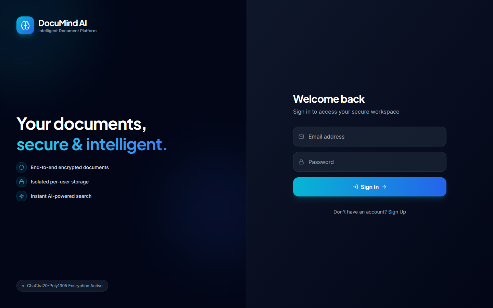
</p>

---

### Query Interface (Dual-Mode)
The main workspace supporting two operational modes:

- **Search Mode**: Enter natural language queries (e.g. `"show my bank statements from 2024"`). Results appear as ranked document cards with relevance percentage meters and direct in-browser decrypted previews.
- **Chat Mode**: Ask analytical questions (e.g. `"What was my total electricity bill for 2023?"`). Multi-turn conversation rendered via the **RichAnswer** component with structured headings, indented body hierarchy, source citation pills, and styled math notation.

<p align="center">
  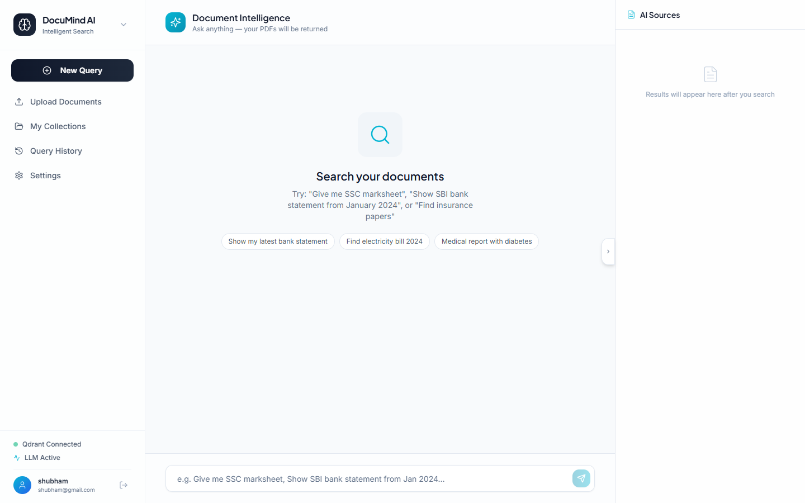
</p>

---

### Upload Documents
- Drag-and-drop zone with instant client-side file inspection (PDF, JPG, PNG up to 20 MB).
- 5-stage real-time progress indicator: `Uploading → Reading → Analyzing → Categorizing → Indexing`.
- Automated blur detection and quality gatekeeper rejecting illegible scans at ingestion.

<p align="center">
  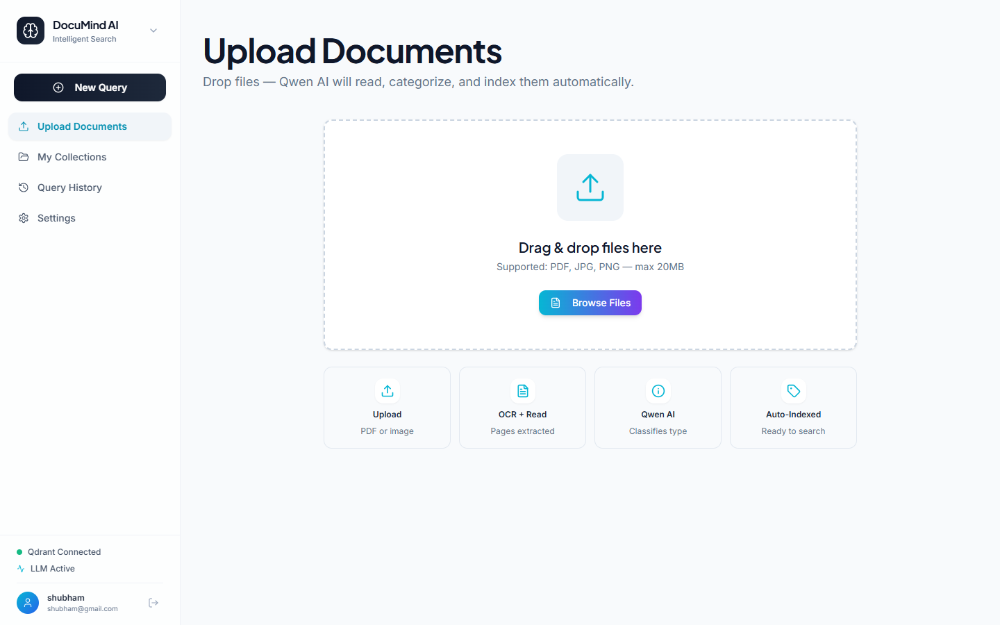
</p>

---

### My Collections
- Automatically categorized folder view of all uploaded documents grouped into AI-detected collections (Aadhaar, PAN Card, Student ID, Project Reports, Resumes, etc.).
- Quick actions per document: 👁️ View (decrypted stream), ⬇️ Download (signed URL), and 🗑️ Delete.

<p align="center">
  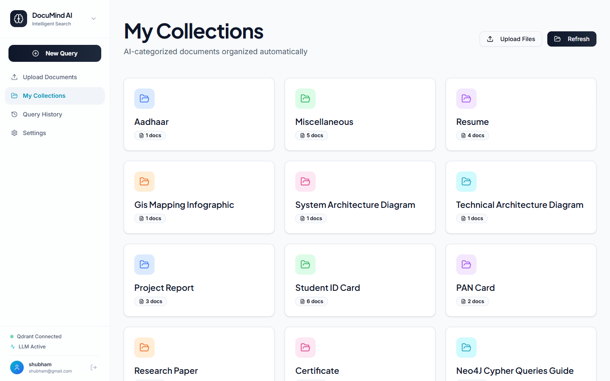
</p>

---

### Query History
- Chronological timeline of all past searches and chat interactions with timestamps.
- One-click query rerun to quickly revisit previous insights.

<p align="center">
  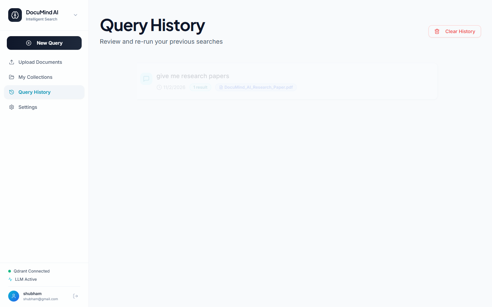
</p>

---

### Settings
- Appearance preferences with persistent Light/Dark theme toggle.
- LLM and embedding model configuration indicators and account profile info.

<p align="center">
  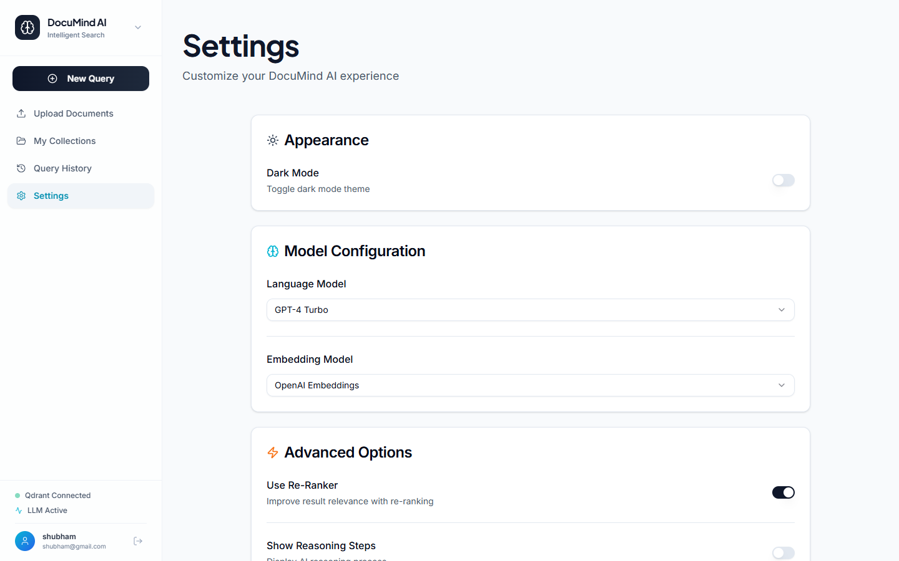
</p>

---

### 404 Page
Custom animated page for unmatched routes:
- **Direct dedicated route**: [`http://localhost:3000/404`](http://localhost:3000/404)
- **Wildcard routes**: Automatically displays inside the application shell when navigating to invalid URLs.

<p align="center">
  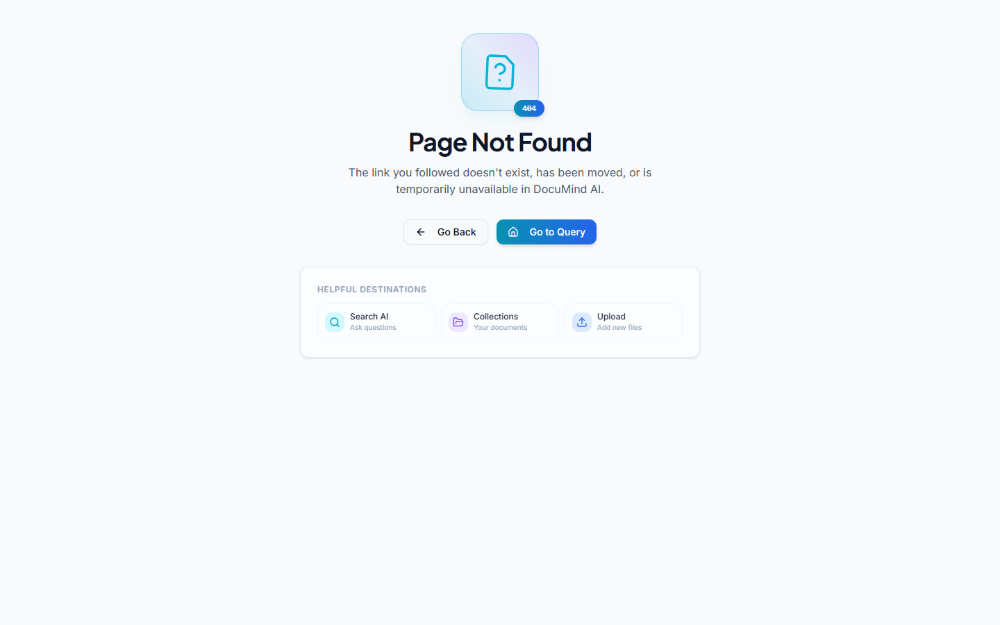
</p>

---

## 14. Known Limitations

| Limitation | Detail |
|:---|:---|
| **Dual-system commit boundary** | Qdrant upserts and S3 uploads are independent operations (no distributed transaction). A crash between them could leave orphaned vectors. The SHA-256 dedup check handles safe re-upload. |
| **Clock sensitivity** | Query temporal filters (year, month) rely on the accuracy of LLM-extracted dates from the document content. OCR errors may cause misclassification. |
| **BGE context window** | The BGE model has a 512-token context window. Chunks longer than 512 tokens are silently truncated at the embedding layer. |
| **OpenRouter rate limits** | Qwen 72B VL calls are subject to OpenRouter rate limits. Burst uploads of many scanned documents may queue. |
| **Local embedding speed** | BGE runs on CPU by default. Processing latency per chunk batch is 15–35ms. GPU acceleration requires CUDA-compatible hardware. |
| **No real-time collaboration** | DocuMind is single-user per session. Documents are strictly isolated per Supabase `user_id`. |
| **Educational scope** | This system is designed for research and educational demonstration. It has not been load-tested beyond a single-user, single-instance deployment. |

---

## License

MIT License — see [LICENSE](LICENSE) for details.

---

<div align="center">
Built with ❤️ by <strong>Dev Shah</strong>, <strong>Shubham Shah</strong>, and <strong>Rishi Shah</strong>
</div>

